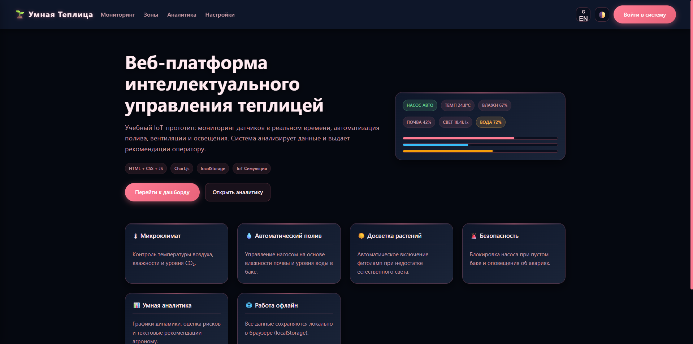
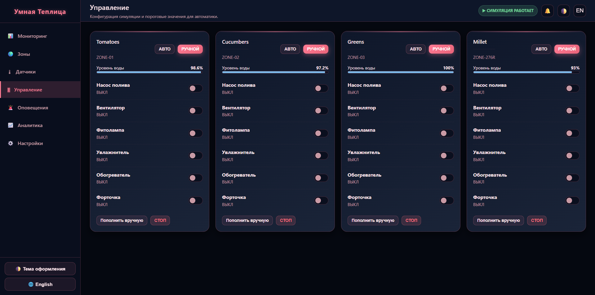
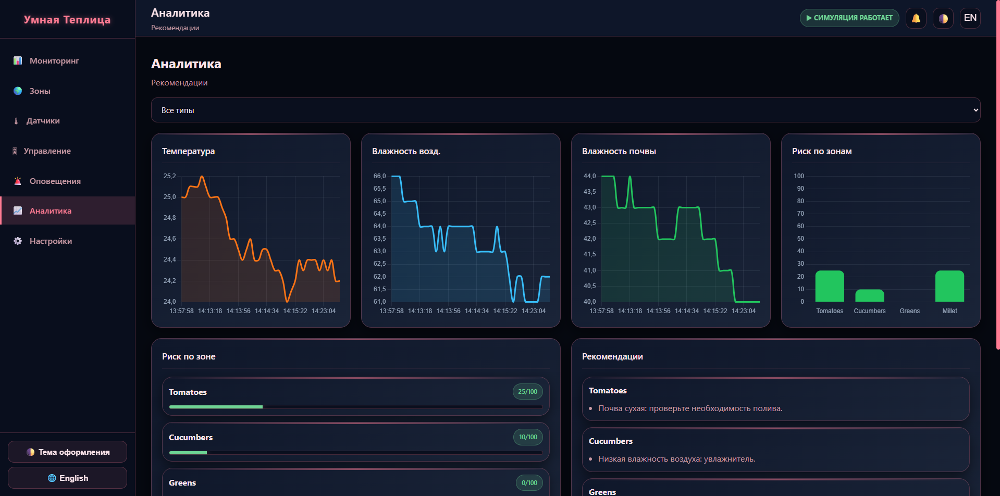
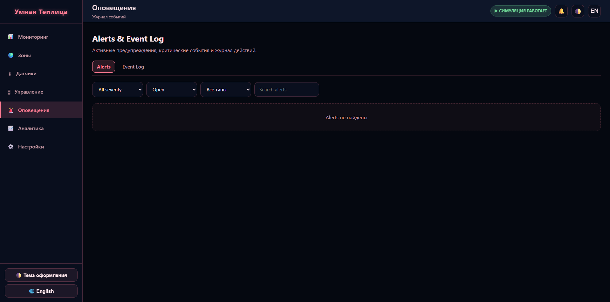
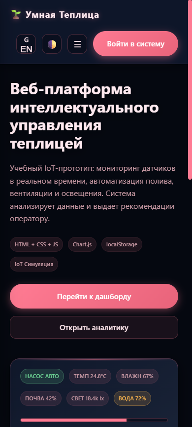
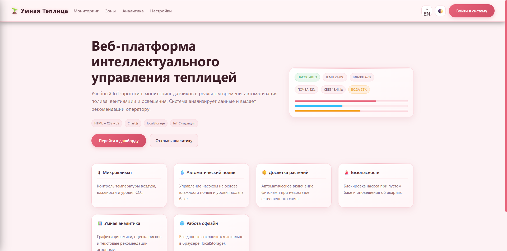
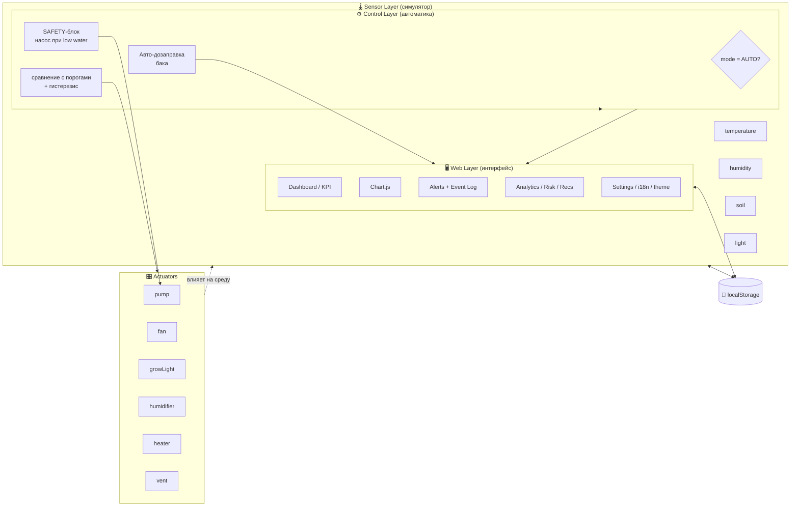
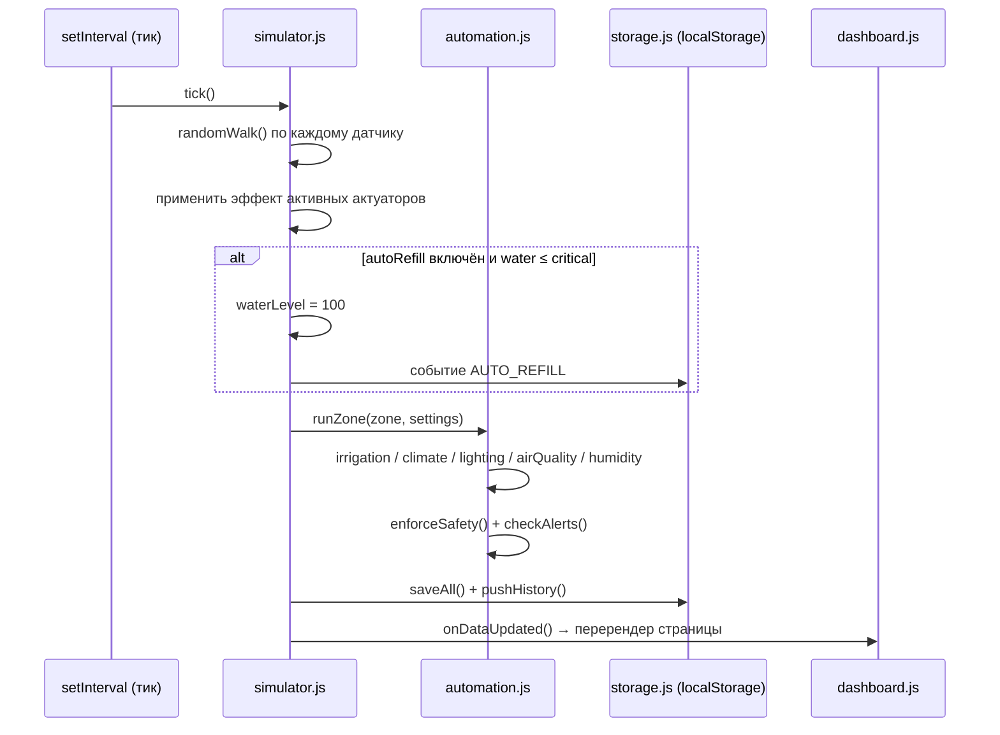

<div align="center">

# 🌱 IoT Smart Greenhouse

### Веб‑платформа интеллектуального управления теплицей

**Учебный IoT‑прототип:** мониторинг датчиков в реальном времени, автоматизация полива,
вентиляции и освещения, аварийные оповещения, аналитика и рекомендации оператору.


[🔗 Демо (GitHub Pages)](https://saisurakamura.github.io/Smart-GreenHouse/) ·
[📖 Методичка](#-требования-методички--реализация) ·
[🧪 Тесты](#-тестирование) ·
[❓ Вопросы к защите](#-контрольные-вопросы-с-ответами)

</div>

---

## 📑 Оглавление

1. [О проекте](#-о-проекте)
2. [Возможности](#-возможности)
3. [Демонстрация](#-демонстрация)
4. [Технологии](#-технологии)
5. [Архитектура](#-архитектура)
6. [Структура проекта](#-структура-проекта)
7. [Быстрый старт](#-быстрый-старт)
8. [Деплой на GitHub Pages](#-деплой-на-github-pages)
9. [Модули интерфейса](#-модули-интерфейса)
10. [Логика автоматики](#-логика-автоматики)
11. [Аналитика](#-аналитика)
12. [Локализация и темы](#-локализация-и-темы)
13. [Модель данных](#-модель-данных)
14. [Тестирование](#-тестирование)
15. [Требования методички → реализация](#-требования-методички--реализация)
16. [История коммитов](#-история-коммитов)
17. [Ограничения](#-ограничения)
18. [Пути расширения](#-пути-расширения)
19. [Вывод](#-вывод)
20. [Контрольные вопросы с ответами](#-контрольные-вопросы-с-ответами)
21. [Лицензия и контакты](#-лицензия-и-контакты)

---

## 📖 О проекте

**IoT Smart Greenhouse** — это статическая веб‑панель (SCADA/IoT dashboard), которая имитирует
работу системы «умная теплица». Проект не требует бэкенда: все данные генерируются
программным **симулятором датчиков** на чистом JavaScript, а состояние сохраняется в
`localStorage` браузера.

Студенческая задача — не сделать рекламный сайт, а построить **рабочий прототип IoT‑системы**
с замкнутым контуром управления:

> датчик → сравнение с порогом → решение автоматики → воздействие на актуатор →
> изменение среды → новый замер.

Финальный результат — опубликованный сайт, который в реальном времени показывает состояние
теплицы на учебных данных и позволяет управлять исполнительными устройствами.

⏱ **Хронометраж:** 12–16 часов &nbsp;·&nbsp; 🎓 **Тип:** лабораторная работа &nbsp;·&nbsp; 📅 **Год:** 2026

---

## ✨ Возможности

<details open>
<summary><b>Развернуть / свернуть список</b></summary>

### 🌡 Мониторинг и телеметрия
- [x] 6 типов датчиков: температура, влажность воздуха, влажность почвы, освещённость, CO₂, уровень воды
- [x] Обновление показаний в реальном времени (настраиваемый тик 3 / 5 / 10 сек)
- [x] KPI‑карточки со средними значениями по теплице
- [x] Индикатор online/offline каждого датчика + ручная эмуляция сбоя
- [x] Пауза и возобновление симуляции одной кнопкой в топбаре

### 🌍 Зоны выращивания
- [x] Минимум 3 независимые зоны (Томаты, Огурцы, Зелень)
- [x] CRUD: добавление, переименование, удаление зон
- [x] Собственный набор пороговых значений у каждой зоны
- [x] Режимы **AUTO** / **MANUAL** per‑zone

### 🎛 Управление актуаторами
- [x] 6 устройств: насос, вентилятор, фитолампа, увлажнитель, обогреватель, форточка
- [x] Ручные тумблеры (активны только в MANUAL)
- [x] Автоматическое управление по порогам (в AUTO)
- [x] **SAFETY‑блок:** насос принудительно выключается при низком уровне воды
- [x] **Авто‑дозаправка** баков до 100 % при падении ниже критического порога (вкл/выкл в настройках)
- [x] Кнопка «Пополнить вручную» и **Emergency Stop**

### 🚨 Оповещения и журнал
- [x] Alerts двух уровней: `warning` / `critical`
- [x] Жизненный цикл: `open → acknowledged → resolved`
- [x] Авто‑снятие алертов при возврате в норму
- [x] Event Log — неизменяемый журнал всех действий с таймстампами
- [x] Фильтры по зоне, источнику, статусу + поиск

### 📈 Аналитика
- [x] 4+ графика на Chart.js (temperature, humidity, soil — line; risk — bar)
- [x] **Risk Score** 0–100 по каждой зоне
- [x] **Recommendation Engine** — текстовые подсказки оператору
- [x] **Anomaly Detector** — поиск резких скачков (≥ 30 % за интервал)
- [x] Фильтр «все зоны / конкретная зона» для графиков

### 🎨 UX и инфраструктура
- [x] Адаптивная вёрстка: 1920 / 1366 / 768 / 390 px
- [x] Выезжающее мобильное меню (бургер + оверлей + блокировка скролла)
- [x] Тёмная и светлая темы с сохранением выбора
- [x] Двуязычный интерфейс **RU / EN** без перезагрузки
- [x] Полное сохранение состояния в `localStorage` (переживает F5)
- [x] Нулевые ошибки в консоли, работа без бэкенда

</details>

---

## 🖼 Демонстрация

> 📸 **Замените пути ниже на свои скриншоты.** Положите изображения в `assets/img/`
> и при необходимости переименуйте файлы. Рекомендуемые виды: Dashboard, Control,
> Analytics, Alerts, мобильная версия 390 px, светлая тема.

|           Dashboard (тёмная тема)           |       Control / AUTO‑логика        |
| :-----------------------------------------: | :--------------------------------: |
|  |  |

|          Analytics + Chart.js          |        Alerts & Event Log        |
| :------------------------------------: | :------------------------------: |
|  |  |

|    Мобильная версия (390 px)     |               Светлая тема               |
| :------------------------------: | :--------------------------------------: |
|  |  |

🔗 **Живое демо:** https://saisurakamura.github.io/Smart-GreenHouse/

---

## 🛠 Технологии

| Технология             | Назначение                                                 |     Статус      |
| ---------------------- | ---------------------------------------------------------- | :-------------: |
| **HTML5**              | Структура 8 страниц (лендинг + 7 разделов панели)          |  Обязательный   |
| **CSS3**               | Grid/Flexbox, темы через `[data-theme]`, анимации, адаптив |  Обязательный   |
| **JavaScript ES6+**    | Симулятор, автоматика, CRUD, i18n, фильтры, рендер UI      |  Обязательный   |
| **Chart.js**           | Line‑графики истории и bar‑график риска                    |  Обязательный   |
| **localStorage**       | Персистентность зон, настроек, алертов, событий, истории   |  Обязательный   |
| **Git / GitHub Pages** | Версионирование и хостинг статики                          |  Обязательный   |
| **Mermaid**            | Диаграммы архитектуры в этом README                        |  Документация   |
| ESP32 / MQTT / Backend | Реальный IoT‑контур                                        | Дополнительно 🔮 |

> 💡 Архитектура сознательно разделена на слои: слой симулятора можно заменить потоком
> данных от ESP32/MQTT **без изменения интерфейса** — достаточно переписать
> `simulator.js` на получение telemetry из внешнего источника.

---

## 🏗 Архитектура

Система построена по слоистой модели, типичной для IoT/SCADA:



### Поток одного тика симуляции



---

## 📂 Структура проекта

```text
iot-smart-greenhouse/
│
├── index.html            # Лендинг + переключатель темы/языка + мобильное меню
├── dashboard.html        # Главный экран мониторинга (KPI, зоны, лента событий)
├── zones.html            # CRUD зон выращивания
├── sensors.html          # Таблица телеметрии + фильтры + эмуляция сбоев
├── control.html          # Manual/Auto, тумблеры актуаторов, SAFETY, дозаправка
├── alerts.html           # Alerts (warning/critical) + Event Log с вкладками
├── analytics.html        # Chart.js: графики, Risk Score, рекомендации, аномалии
├── settings.html         # Пороги per‑zone, тема, язык, скорость, autoRefill, сброс
├── README.md             # Этот файл
│
└── assets/
    ├── css/
    │   └── style.css     # Единый стиль: лендинг + дашборд + темы + адаптив
    ├── js/
    │   ├── data.js       # Константы, утилиты, модель зоны, словарь i18n (RU/EN)
    │   ├── storage.js    # Загрузка/нормализация/сохранение/сброс localStorage
    │   ├── simulator.js  # Генерация телеметрии, тик, авто‑дозаправка, история
    │   ├── automation.js # Логика AUTO/SAFETY, гистерезис, управление актуаторами
    │   ├── dashboard.js  # Рендер оболочки и всех страниц, обработчики, i18n‑UI
    │   ├── alerts.js     # Создание/решение алертов, Event Log, фильтры страниц
    │   └── analytics.js  # Risk score, аномалии, рекомендации, построение графиков
    └── img/              # Скриншоты для README (заполнить при сдаче)
```

> ⚠️ CSS и JavaScript вынесены в **отдельные файлы**. Один огромный `index.html`
> не соответствует требованиям методички.

---

## 🚀 Быстрый старт

Проект — чистая статика, сборка не нужна. Но `localStorage` корректно работает только
через HTTP, поэтому **не открывайте файлы через `file://`**.

### Вариант A — VS Code + Live Server (рекомендуется)

1. Установите расширение **Live Server**.
2. Откройте папку проекта в VS Code.
3. ПКМ по `index.html` → *Open with Live Server* (или `Go Live`).
4. Браузер откроет `http://127.0.0.1:5500/index.html`.

### Вариант B — любой локальный HTTP‑сервер

```bash
# Python 3
python -m http.server 5500

# Node.js
npx serve -l 5500
```

Затем откройте `http://localhost:5500/`.

### Что проверить после запуска

- [ ] Лендинг открывается, кнопки ведут в панель
- [ ] На `dashboard.html` значения меняются каждые N секунд
- [ ] Кнопка статуса симуляции ставит/снимает паузу
- [ ] Переключатели 🌓 (тема) и EN/RU (язык) работают на всех страницах
- [ ] На `control.html` в AUTO тумблеры заблокированы, в MANUAL — активны
- [ ] После **F5** зоны, настройки, история и алерты сохранены
- [ ] Консоль браузера (F12) без ошибок

---

## 🌐 Деплой на GitHub Pages

### 1. Создать репозиторий и запушить

```bash
git init
git add .
git commit -m "Create IoT Smart Greenhouse dashboard"
git branch -M main
git push -u origin main
```

### 2. Включить Pages

1. Repository → **Settings** → **Pages**.
2. *Build and deployment* → Source: **Deploy from a branch**.
3. Branch: `main` / folder: `/ (root)` → **Save**.
4. Через 1–2 минуты сайт будет доступен по ссылке вида
   `https://saisurakamura.github.io/Smart-GreenHouse/`.

### 3. Обновление после правок

```bash
git add .
git commit -m "Update sensor thresholds and analytics"
git push
```

> 🔒 **Никогда** не публикуйте в публичном репозитории секретные API‑ключи, токены,
> пароли MQTT или доступы к реальному оборудованию. В этом проекте секретов нет —
> всё работает на клиенте.

---

## 🧩 Модули интерфейса

| Страница         | Что делает                | Ключевые элементы                                              |
| ---------------- | ------------------------- | -------------------------------------------------------------- |
| `index.html`     | Витрина проекта           | Hero, превью‑карточка, features, тема/язык/бургер              |
| `dashboard.html` | Оперативный обзор         | 6 KPI, карточки зон с Risk, ленты alerts/events                |
| `zones.html`     | Управление участками      | Добавление/переименование/удаление зон, сводка порогов         |
| `sensors.html`   | Телеметрия                | Таблица value/unit/zone/status/time, фильтры, вкл/выкл датчика |
| `control.html`   | Исполнительные устройства | AUTO/MANUAL, тумблеры, SAFETY‑баннер, дозаправка, E‑Stop       |
| `alerts.html`    | Аварии и журнал           | Вкладки Alerts / Event Log, ack/resolve, фильтры, поиск        |
| `analytics.html` | Интеллектуальный модуль   | 4 графика, risk‑карточки, рекомендации, детектор аномалий      |
| `settings.html`  | Конфигурация              | Глобальные параметры + крупные поля порогов per‑zone, сброс    |

---

## ⚙️ Логика автоматики

### Учебные пороги зоны (фрагмент модели)

```js
const zoneSettings = {
  temperature: { min: 20, max: 28 },   // °C
  humidity:    { min: 50, max: 80 },   // %
  soil:        { min: 35, max: 75 },   // %
  light:       { min: 12000 },         // lx
  co2:         { max: 1500 },          // ppm
  waterLevel:  { critical: 15 },       // % — порог SAFETY
  hysteresis:  1.5                     // ширина гистерезиса
};
```

> 🌱 Значения **учебные** и не являются универсальными агрономическими нормами.
> Реальные пороги зависят от культуры, фазы роста, субстрата и оборудования.
> Все они редактируются через страницу **Settings**.

### Три контура управления

| Режим      | Поведение                                                                |
| ---------- | ------------------------------------------------------------------------ |
| **MANUAL** | Оператор вручную включает/выключает актуаторы тумблерами                 |
| **AUTO**   | JavaScript сравнивает показания с порогами и сам управляет устройствами  |
| **SAFETY** | Независимо от режима: при `waterLevel ≤ critical` насос **заблокирован** |

### Гистерезис (защита от дребезга)

Насос включается при `soil < min`, но выключается только при достижении `soil ≥ min + hysteresis`
(или `soil ≥ max`). Аналогично для вентилятора, обогревателя, увлажнителя и фитолампы —
это предотвращает частое переключение реле около одной границы.

### Авто‑дозаправка воды

```text
если config.autoRefill == true
   и waterLevel <= settings.waterLevel.critical:
        waterLevel = 100
        записать событие AUTO_REFILL в Event Log
        снять алерты waterLow и pumpBlocked
```

Кнопка **«Пополнить вручную»** работает всегда и независимо от этой настройки.

### Пример базовой автоматики (полив + климат)

```js
function runAutomation(zone, settings) {
  const actions = [];

  // Полив с учётом SAFETY
  if (zone.soil < settings.soil.min) {
    if (zone.waterLevel > settings.waterLevel.critical) {
      zone.actuators.pump = true;
      actions.push("Pump ON: low soil moisture");
    } else {
      zone.actuators.pump = false;
      actions.push("Pump blocked: low water level");
    }
  }
  if (zone.soil >= settings.soil.max) zone.actuators.pump = false;

  // Вентиляция / обогрев / досветка
  zone.actuators.fan       = zone.temperature > settings.temperature.max;
  zone.actuators.heater    = zone.temperature < settings.temperature.min;
  zone.actuators.growLight = zone.light       < settings.light.min;

  return actions;
}
```

---

## 🧠 Аналитика

Обязательная часть выполняется **локально, без платных AI API**.

### 1. Risk Score (0–100)

```js
function calculateRisk(zone, settings) {
  let score = 0;
  if (zone.temperature > settings.temperature.max) score += 25;
  if (zone.temperature < settings.temperature.min) score += 20;
  if (zone.soil        < settings.soil.min)         score += 25;
  if (zone.waterLevel <= settings.waterLevel.critical) score += 30;
  else if (zone.waterLevel < settings.waterLevel.critical + 10) score += 10;
  if (zone.co2         > settings.co2.max)          score += 15;
  if (zone.humidity  < min || > max)                score += 10;
  if (zone.light       < settings.light.min)        score += 10;
  if (есть offline‑датчики)                          score += 10;
  return Math.min(score, 100);
}
```

Цветовая градация: `0–29` 🟢 стабильно · `30–59` 🟡 внимание · `60–100` 🔴 риск.

### 2. Детектор аномалий

```js
function percentChange(prev, cur) {
  if (prev === 0) return 0;
  return Math.abs(((cur - prev) / prev) * 100);
}
// считаем аномалией скачок ≥ 30 % между двумя последними снапшотами истории
```

### 3. Recommendation Engine

Аналитика показывает **не только число, но и объяснение**:
*что произошло → почему это важно → какое действие рекомендуется*.

Пример вывода для зоны с пустым баком:

> 💧 **Критически низкий уровень воды: полив заблокирован, пополните бак.**

Если отклонений нет — система сообщает *«Состояние зоны стабильно»*.

---

## 🌐 Локализация и темы

### Двухязычный интерфейс (RU / EN)

Весь текст вынесен в словарь `GH.i18n.dict` и рендерится через `GH.i18n.t(key, params)`.
Переключение языка (**EN/RU** в топбаре или кнопка в сайдбаре) происходит **мгновенно**,
без перезагрузки: оболочка и текущая страница перерисовываются. Выбор сохраняется в
`localStorage` под ключом `gh_lang`.

### Тёмная / светлая тема

Темы реализованы через CSS‑переменные и атрибут `[data-theme]` на `<html>`.
По умолчанию — **тёмная** (чёрно‑синий фон `#050810`, розово‑вишнёвые акценты).
Светлая тема использует нежные розовые тона. Переключение 🌓 сохраняет выбор в
`localStorage` (`gh_theme`) и синхронизировано между лендингом и панелью.

---

## 💾 Модель данных

### Ключи `localStorage`

| Ключ          | Содержимое                                                                                        |
| ------------- | ------------------------------------------------------------------------------------------------- |
| `gh_zones`    | Массив зон с показаниями, режимом, актуаторами, статусами датчиков                                |
| `gh_settings` | Пороговые значения per‑zone                                                                       |
| `gh_config`   | Глобальная конфигурация: тема, скорость, `running`, `randomFailures`, `autoRefill`, длина истории |
| `gh_alerts`   | Лента оповещений (до 200 записей)                                                                 |
| `gh_events`   | Журнал действий (до 300 записей)                                                                  |
| `gh_history`  | Снапшоты телеметрии для графиков (циклируется по `historyLength`)                                 |
| `gh_theme`    | Выбранная тема (`dark` / `light`) — общий ключ для лендинга и панели                              |
| `gh_lang`     | Выбранный язык (`ru` / `en`) — общий ключ                                                         |

### Пример объекта Zone

```json
{
  "id": "ZONE-01",
  "name": "Томаты",
  "temperature": 24.8,
  "humidity": 67,
  "soil": 42,
  "light": 18400,
  "co2": 820,
  "waterLevel": 72,
  "mode": "auto",
  "actuators": { "pump": false, "fan": false, "growLight": false, "humidifier": false, "heater": false, "vent": false },
  "sensorsOnline": { "temperature": true, "humidity": true, "soil": true, "light": true, "co2": true, "waterLevel": true },
  "lastUpdate": 1761034500000
}
```

### Пример Alert и Event

```json
{ "id": "ALERT-A1B2C3", "zoneId": "ZONE-01", "type": "soilLow", "severity": "warning", "message": "Soil moisture 30% is below threshold 35%", "status": "open", "createdAt": 1761034500000 }
```
```json
{ "id": "9F3K2L", "zoneId": "ZONE-01", "source": "automation", "action": "PUMP_ON", "message": "Pump ON: soil 30% < 35%", "timestamp": 1761034505000 }
```

---

## 🧪 Тестирование

### Обязательные сценарии методички

| №   | Сценарий                        | Ожидаемый результат                         | Статус |
| --- | ------------------------------- | ------------------------------------------- | :----: |
| 1   | Soil ниже min, вода есть, AUTO  | Pump ON + запись в Event Log                |   ✅    |
| 2   | Soil ниже min, water ≤ critical | Pump блокируется + Critical Alert           |   ✅    |
| 3   | Temperature выше max            | Fan ON                                      |   ✅    |
| 4   | Temperature ниже min            | Heater ON                                   |   ✅    |
| 5   | Light ниже min                  | Grow Light ON                               |   ✅    |
| 6   | Manual Mode                     | Оператор включает актуаторы вручную         |   ✅    |
| 7   | Auto Mode                       | Ручные тумблеры заблокированы               |   ✅    |
| 8   | Refresh страницы (F5)           | Настройки, зоны, история, события сохранены |   ✅    |
| 9   | Mobile 390 px                   | Нет горизонтального развала, меню выезжает  |   ✅    |
| 10  | Console (F12)                   | Нет JavaScript errors                       |   ✅    |

### Дополнительные сценарии (сверх базы)

| №   | Сценарий                                     | Ожидаемый результат                                   | Статус |
| --- | -------------------------------------------- | ----------------------------------------------------- | :----: |
| 11  | Клик по статусу симуляции                    | Пауза/возобновление, смена цвета пилюли, запись в лог |   ✅    |
| 12  | Переключение языка EN/RU                     | Весь интерфейс переводится без перезагрузки           |   ✅    |
| 13  | Переключение темы 🌓                          | Тёмная ↔ светлая, выбор сохраняется                   |   ✅    |
| 14  | `autoRefill = ON`, вода падает ниже critical | Бак автоматически = 100 %, алерты сняты               |   ✅    |
| 15  | `randomFailures = ON`                        | Датчики периодически уходят offline → warning‑alert   |   ✅    |
| 16  | Emergency Stop                               | Все актуаторы OFF, зона переходит в MANUAL            |   ✅    |
| 17  | Добавление / удаление зоны                   | CRUD работает, минимум 3 зоны защищён                 |   ✅    |
| 18  | Фильтры и поиск на Sensors/Alerts            | Выборка корректна по зоне/типу/статусу/тексту         |   ✅    |

---

## 📋 Требования методички → реализация

| Требование                | Где реализовано                               | Статус |
| ------------------------- | --------------------------------------------- | :----: |
| 3+ зоны                   | `data.js` defaults + CRUD на `zones.html`     |   ✅    |
| 6 типов датчиков          | `GH.sensorMeta` (temperature…waterLevel)      |   ✅    |
| Manual Mode               | `control.html` + `automation.setActuator`     |   ✅    |
| Auto Mode                 | `automation.runZone` по порогам               |   ✅    |
| SAFETY‑блок насоса        | `automation.enforceSafety` + баннер           |   ✅    |
| Alerts (warning/critical) | `alerts.js` + `alerts.html`                   |   ✅    |
| Event Log                 | `GH.events.add` + вкладка на `alerts.html`    |   ✅    |
| 4+ графика                | `analytics.js` (3 line + 1 bar)               |   ✅    |
| Risk Score                | `analytics.calculateRisk`                     |   ✅    |
| Рекомендации              | `analytics.getRecommendations`                |   ✅    |
| localStorage              | `storage.js` (6 ключей состояния + тема/язык) |   ✅    |
| Responsive                | `style.css` медиазапросы 992/768/600/390 px   |   ✅    |
| Отдельные CSS/JS файлы    | `assets/css/`, `assets/js/`                   |   ✅    |
| GitHub Pages              | Инструкция выше + деплой                      |   ✅    |
| Тема Dark/Light           | `[data-theme]` + переключатель                |   ✅    |
| i18n RU/EN *(бонус)*      | `GH.i18n` + перерендер UI                     |   ✅    |
| Авто‑дозаправка *(бонус)* | `simulator.tick` + настройка                  |   ✅    |
| Пауза симуляции *(бонус)* | `toggleSimulation` в топбаре                  |   ✅    |

---

## 📝 История коммитов

Ниже — целевая история; при первом
публиковании можно разбить `git add` по модулям, чтобы коммиты были тематическими:

```bash
git commit -m "Create greenhouse dashboard and landing page"
git commit -m "Add sensor simulator with random-walk telemetry"
git commit -m "Implement automatic irrigation and SAFETY pump block"
git commit -m "Add Chart.js analytics, risk score and recommendations"
git commit -m "Add alerts, event log and responsive layout"
git commit -m "Add RU/EN localization, dark/light theme and auto-refill"
```

---

## ⚠️ Ограничения

- **Нет реального железа.** Данные синтетические; пороги учебные и не заменяют агронома.
- **Только клиентская сторона.** Нет авторизации, многопользовательскости и серверной БД;
  `localStorage` привязан к одному браузеру/профилю.
- **Хранение ограничено.** Алерты ≤ 200, события ≤ 300, история циклически обрезается —
  это сделано намеренно, чтобы не переполнять квоту браузера.
- **Chart.js через CDN.** Для полностью офлайн‑режима библиотеку нужно положить локально.
- **Аномалии** считаются по двум последним снапшотам (простейший пороговый метод),
  а не по статистическим моделям.

---

## 🔮 Пути расширения

| Направление           | Идея                                                                                                |
| --------------------- | --------------------------------------------------------------------------------------------------- |
| **ESP32 / датчики**   | Заменить `simulator.js` на чтение реальной telemetry (DHT22, ёмкостный датчик почвы, BH1750, SCD30) |
| **MQTT**              | Подключить broker для приёма данных и отправки команд pump/fan                                      |
| **Backend**           | Node.js/Express, FastAPI или Laravel + БД для истории и пользователей                               |
| **WebSocket / SSE**   | Real‑time push вместо polling‑тика                                                                  |
| **CSV / JSON export** | Выгрузка истории показаний и журнала событий                                                        |
| **Weather API**       | Сравнение внутренних условий с внешней погодой (через backend, секреты не во фронтенде)             |
| **ML‑рекомендации**   | Обучение модели прогноза риска на накопленной истории                                               |

---

## 🎯 Вывод

В ходе лабораторной работы создана комплексная веб‑платформа, демонстрирующая принципы
построения IoT‑систем реального времени **без использования тяжёлых фреймворков и бэкенда**.

**Основные достижения:**

1. Освоен навык построения SPA‑подобных интерфейсов на чистом JavaScript с роутингом по
   отдельным HTML‑страницам и централизованным рендером.
2. Понята логика **замкнутого контура автоматики**: датчик → порог → решение → актуатор →
   изменение среды → новый замер, включая гистерезис и SAFETY‑блокировки.
3. Реализованы механизмы защиты оборудования (блокировка насоса при низком уровне воды) и
   обеспечения непрерывности процесса (авто‑дозаправка баков).
4. Получен опыт визуализации данных (Chart.js), структурирования логов событий,
   локализации интерфейса (RU/EN) и темизации через CSS‑переменные.
5. Освоено персистентное хранение состояния в `localStorage` и публикация статики на
   GitHub Pages.

Проект полностью соответствует требованиям методички, проходит все обязательные тест‑кейсы
и готов к демонстрации и защите.

---

## ❓ Контрольные вопросы с ответами

<details>
<summary><b>Нажмите, чтобы раскрыть вопросы и краткие ответы</b></summary>

1. **Что такое IoT Smart Greenhouse?**
   Система «интернета вещей» для теплицы: сеть датчиков собирает данные о среде, контроллер
   принимает решения по порогам, исполнительные устройства воздействуют на климат и полив,
   а веб‑панель визуализирует процесс и даёт оператору управление.

2. **Чем sensor отличается от actuator?**
   *Sensor* (датчик) **измеряет** параметр среды и отдаёт значение (температура, почва…).
   *Actuator* (актуатор) **воздействует** на среду, преобразуя команду в физическое действие
   (насос льёт воду, вентилятор охлаждает, лампа освещает).

3. **Зачем разделять Manual и Auto?**
   AUTO обеспечивает непрерывную работу по правилам без участия человека; MANUAL нужен для
   обслуживания, отладки, экстренного вмешательства и ситуаций, когда алгоритм нельзя
   доверять (например, при калибровке датчиков).

4. **Почему насос должен блокироваться при низком уровне воды?**
   Работа «на сухую» выводит насос из строя (сухой ход, перегрев). SAFETY‑блок приоритетнее
   любой логики полива — это защита оборудования.

5. **Что такое telemetry?**
   Поток измерений от датчиков с привязкой ко времени и источнику (зона/устройство). В проекте
   telemetry — это значения 6 датчиков каждой зоны, обновляемые каждый тик.

6. **Что такое threshold?**
   Пороговое значение, при пересечении которого система меняет состояние (включает/выключает
   актуатор или создаёт алерт). В работе пороги учебные и настраиваются в Settings.

7. **Что такое hysteresis?**
   Разница между порогами включения и выключения. Нужна, чтобы устройство не щёлкало
   туда‑обратно при колебаниях значения вокруг одной границы (защита от дребезга).

8. **Для чего нужен Event Log?**
   Для аудита и отладки: неизменяемая хронология всех автоматических и ручных действий с
   таймстампами, источником и зоной. Позволяет восстановить, *почему* система приняла решение.

9. **Что хранится в localStorage?**
   Зоны, настройки порогов, глобальная конфигурация, алерты, события, история для графиков,
   а также выбранные тема и язык. Всё переживает перезагрузку страницы.

10. **Для чего используется Chart.js?**
    Для визуализации динамики телеметрии (line‑графики температуры/влажности/почвы) и
    распределения Risk Score по зонам (bar‑график).

11. **Что такое anomaly?**
    Аномалия — резкое, необъяснённое изменение показания между двумя соседними снапшотами
    (в проекте — скачок ≥ 30 %). Может сигнализировать о неисправности датчика или аварии.

12. **Как рассчитывается risk score?**
    Аддитивно: за каждое отклонение параметра от нормы начисляются баллы (перегрев +25,
    сухая почва +25, пустой бак +30 и т. д.), сумма ограничивается сверху 100.

13. **Почему рекомендации не заменяют агронома?**
    Они основаны на простых учебных порогах и локальной логике, не учитывают фазу роста,
    сорт, субстрат, экономику и внешние условия. Это подсказка оператору, а не экспертное
    заключение.

14. **Как подключить ESP32 к этой платформе?**
    Заменить слой симулятора: вместо `randomWalk` читать telemetry из источника (HTTP‑запрос
    к backend, WebSocket или MQTT‑subscriber) и записывать те же поля объекта зоны.
    Интерфейс и автоматика останутся без изменений.

15. **Для чего в IoT используется MQTT?**
    Лёгкий publish/subscribe протокол для обмена телеметрией и командами между устройствами
    и сервером с минимальными накладными расходами и поддержкой офлайн‑буферизации.

16. **Почему секреты нельзя хранить во фронтенд JavaScript?**
    Любой код браузера виден пользователю (DevTools, исходники). API‑ключи, токены и пароли
    должны храниться на backend и выдаваться через прокси‑запросы, иначе они утекут в публичный
    репозиторий и станут доступны всем.

</details>

---

## 📄 Лицензия и контакты

Проект выполнен в учебных целях в рамках лабораторной работы по веб‑разработке / IoT.
Код можно использовать как основу для дальнейших экспериментов (подключение ESP32, MQTT, backend).

|                   |                                                  |
| ----------------- | ------------------------------------------------ |
| 👤 **Студент**     | *ФИО, группа*                                    |
| 🎓 **Дисциплина**  | Веб‑разработка / IoT                             |
| 📅 **Дата**        | 21 октября 2026                                  |
| 🔗 **Репозиторий** | https://github.com/SaiSurakamura/Smart-GreenHouse |
| 🌐 **Демо**        | https://saisurakamura.github.io/Smart-GreenHouse/ |

<div align="center">

**IoT Smart Greenhouse** · Web + IoT + Analytics · 2026
*Сделано на чистом HTML / CSS / JS + Chart.js · без бэкенда* 🌱

</div>